# TP 1 - Mise en place du protocole SSH

DGI-ESP / UCAD - L3 GLSI - 2026-2027
Services Réseaux Avancés

Binôme : El Hadji Ibra Diagne et Aminata Gueye
Enseignant : Dr Gueye

## 1. Introduction

SSH permet de se connecter à une machine à distance de façon sécurisée. Tout ce qui passe entre les deux machines est chiffré. Le serveur attend les connexions sur le port 22 et le client vient s'y connecter.

## 2. Organisation

On a commencé sur mon PC (Debian 13) pour installer et vérifier le service SSH. Comme nos deux PC n'étaient pas sur le même réseau Wi-Fi, on a fait la suite avec les deux machines d'Aminata :

- serveur : une machine virtuelle Ubuntu 26.04 sur VirtualBox, adresse 192.168.1.39
- client : son PC Windows, adresse 192.168.1.5

## 3. Installation du serveur SSH

Les captures de cette partie ont été prises sur mon PC Debian.

```
sudo apt install openssh-server apache2 mariadb-server
sudo systemctl enable ssh
sudo systemctl start ssh
```

Apache2 et MariaDB servent pour les tunnels de la partie 6. `enable` lance SSH à chaque démarrage et `start` le lance tout de suite.

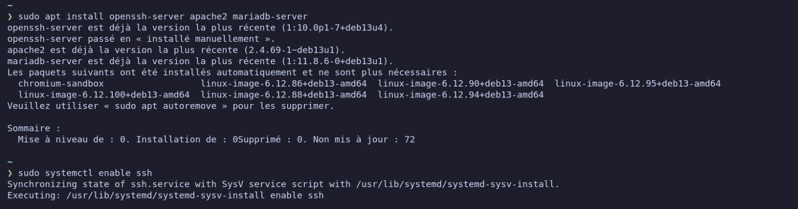

Capture 1 : installation des paquets

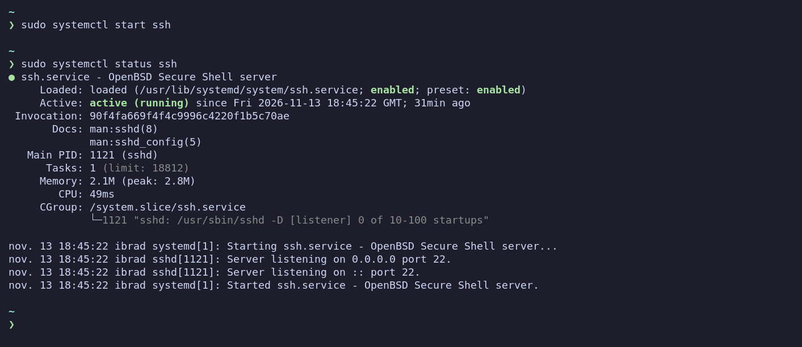

Capture 2 : le service SSH est actif et écoute sur le port 22

On vérifie avec `ss` que le port 22 est bien ouvert et utilisé par sshd :

```
sudo ss -tlnp | grep :22
```

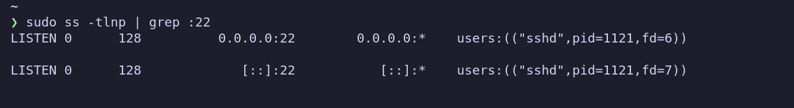

Capture 3 : le port 22 est ouvert

On a ensuite installé les mêmes paquets sur la VM Ubuntu d'Aminata, qui sert de serveur pour la suite.

## 4. Connexion depuis le client

Depuis le PC Windows, on se connecte au serveur Ubuntu :

```
ssh aminata@192.168.1.39
```

À la première connexion, SSH affiche l'empreinte du serveur. Après avoir répondu yes, elle est enregistrée dans known_hosts, ce qui permet de reconnaître le serveur les fois suivantes. Après le mot de passe, on se retrouve sur le terminal du serveur.

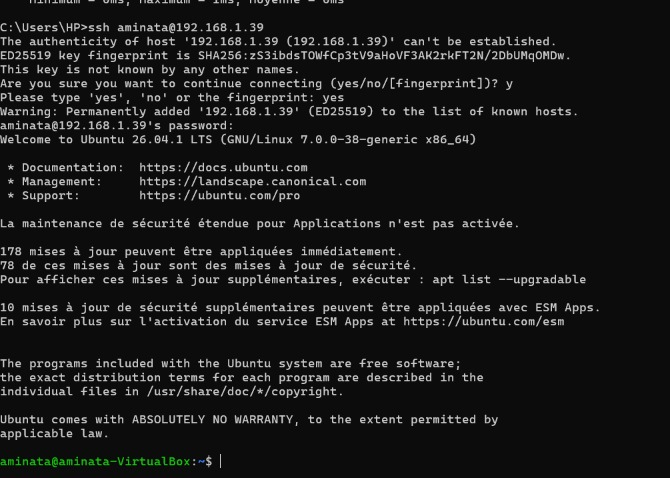

Capture 4 : connexion du client Windows au serveur Ubuntu

## 5. Clés SSH

Une paire de clés permet de ne plus utiliser le mot de passe. La clé privée (id_rsa) reste sur la machine qui l'a créée, et la clé publique (id_rsa.pub) est copiée dans le fichier authorized_keys de la machine à laquelle on veut se connecter, ici le serveur.

On crée la paire de clés avec :

```
ssh-keygen -t rsa
```

Les clés se trouvent dans le dossier caché .ssh. Les captures 5 et 6 montrent ce dossier sur le serveur Ubuntu.

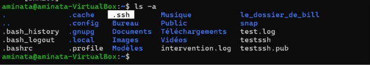

Capture 5 : le dossier caché .ssh

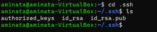

Capture 6 : les clés et le fichier authorized_keys

Une fois la clé publique du client placée dans authorized_keys sur le serveur, on s'est reconnecté depuis Windows. Cette fois le serveur n'a pas demandé de mot de passe, la connexion s'est faite avec la clé.

```
ssh aminata@192.168.1.39
```

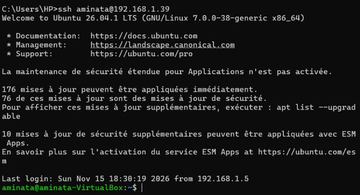

Capture 7 : connexion par clé, sans mot de passe

## 6. Tunnel SSH

Un tunnel permet de faire passer un autre service dans la connexion SSH, qui est chiffrée. Avec `ssh -L`, on relie un port de la machine qui lance la commande à un port du serveur.

Tunnel vers le serveur web Apache :

```
ssh -L 1024:127.0.0.1:80 aminata@192.168.1.39
```

Le port 1024 de la machine qui lance la commande est relié au port 80 (Apache) du serveur.

On a d'abord fait un premier essai depuis la VM elle-même. Comme la VM se connectait à elle-même pour la première fois, SSH a redemandé l'empreinte et le mot de passe.

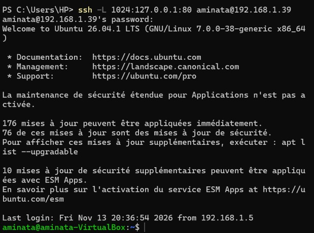

Capture 8 : premier essai du tunnel, lancé depuis la VM

On a ensuite lancé la même commande depuis le PC Windows, qui est le vrai client. Pendant que la connexion SSH reste ouverte, on vérifie dans PowerShell que le port 1024 répond bien sur le client :

```
Test-NetConnection -ComputerName 127.0.0.1 -Port 1024
```

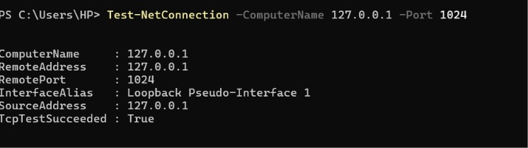

Capture 9 : le port 1024 répond sur le client Windows

Enfin, on ouvre http://localhost:1024 dans le navigateur de Windows. La page par défaut d'Apache sur Ubuntu s'affiche. Apache n'est pas installé sur le PC Windows, donc cette page vient bien du serveur et elle est passée par le tunnel SSH.

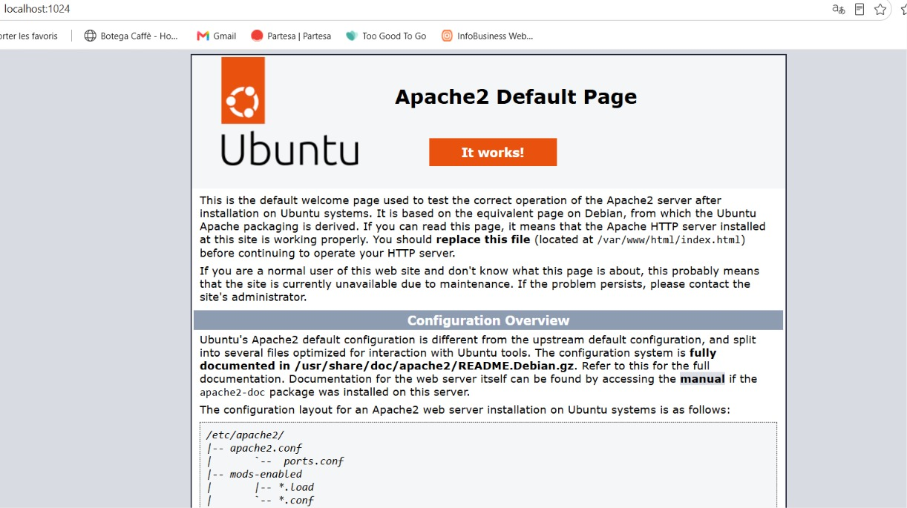

Capture 10 : la page Apache du serveur affichée sur le client grâce au tunnel

Tunnel vers MariaDB, lancé lui aussi depuis le PC Windows :

```
ssh -L 3307:127.0.0.1:3306 aminata@192.168.1.39
```

Le port 3307 du client est relié au port 3306 (MariaDB) du serveur. On a vérifié sur Windows que le port répond :

```
Test-NetConnection -ComputerName 127.0.0.1 -Port 3307
```

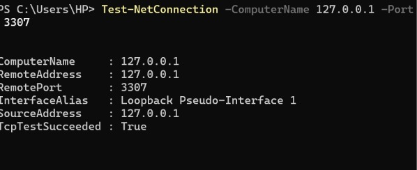

Capture 11 : le test du port 3307 a réussi

## 7. Difficultés

Nos PC n'étaient pas sur le même réseau, donc on a utilisé les deux machines d'Aminata.

Au début, le mot de passe était toujours demandé même après avoir créé les clés. Il fallait mettre la clé publique du client dans authorized_keys sur le serveur, c'est-à-dire la machine à laquelle on se connecte. Après ça, la connexion s'est faite sans mot de passe.

## 8. Conclusion

Ce TP nous a permis d'installer un serveur SSH, de nous y connecter, d'utiliser les clés et de créer des tunnels pour accéder de façon sécurisée à un site web et à une base de données.
