# TP 2 - Bureau à distance (RDP et VNC à travers un tunnel SSH)

DGI-ESP / UCAD - L3 GLSI - 2026-2027
Services Réseaux Avancés

Étudiant : El Hadji Ibra Diagne
Enseignant : Dr Gueye

## 1. Objectif

Le bureau à distance permet d'utiliser l'écran, le clavier et la souris d'un ordinateur depuis un autre ordinateur. Dans ce TP, on affiche le bureau d'une machine Ubuntu (une machine virtuelle, adresse 192.168.1.78) depuis un PC Windows, avec deux protocoles : RDP et VNC.

Dans les deux cas, la connexion passe dans un tunnel SSH, donc tout le trafic est chiffré. Pour chaque étape, j'explique à quoi sert la commande. J'indique aussi les erreurs que j'ai eues pendant le TP, pourquoi elles sont arrivées et comment je les ai réglées.

## 2. Ce qu'il faut avant de commencer

- Une machine virtuelle Ubuntu dans VirtualBox, avec la carte réseau en « Accès par pont ». Comme ça, elle a sa propre adresse sur le réseau, comme un vrai PC.
- Le serveur SSH installé sur Ubuntu avec `sudo apt install openssh-server`. Sur Ubuntu 24.04, il démarre tout seul à la première connexion.
- Un PC Windows sur le même réseau. La commande `ssh` est déjà intégrée dans PowerShell.

Petit conseil : il faut ouvrir deux fenêtres et ne pas les mélanger. Une sur Ubuntu pour configurer le serveur, une sur Windows (PowerShell) pour le tunnel. Beaucoup de mes erreurs venaient de là.

## 3. Le principe du tunnel SSH

La commande `ssh -L port_local:127.0.0.1:port_distant utilisateur@serveur` ouvre une connexion SSH et crée une redirection. Tout ce qui arrive sur le port local du PC Windows passe dans la connexion chiffrée, puis arrive sur le port distant de la machine Ubuntu. Le client de bureau à distance se connecte donc à « localhost », c'est-à-dire au tunnel, et pas directement à la machine.

À retenir : le tunnel se lance toujours depuis le PC client (PowerShell sur Windows, avec le prompt `PS C:\Users\...`), jamais depuis la machine Ubuntu.

## 4. Partie 1 : RDP avec xrdp

RDP (Remote Desktop Protocol) est le protocole de bureau à distance de Microsoft. Il utilise le port 3389. Windows a déjà un client RDP, mais Ubuntu n'a pas de serveur RDP, donc on installe xrdp.

### Étape 1 : installer xrdp

```
sudo apt install xrdp
```

xrdp est un serveur RDP libre pour Linux. apt installe aussi xorgxrdp, qui ouvre une vraie session graphique pour chaque connexion, et un module PipeWire pour le son.

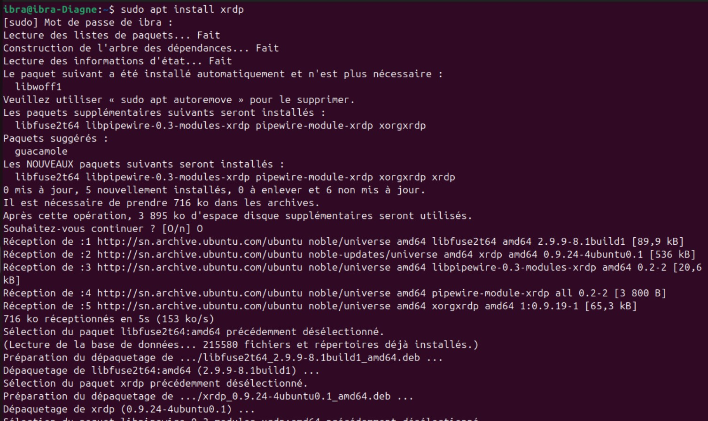

Capture 1 : installation de xrdp

### Étape 2 : configurer et démarrer le service

```
sudo nano /etc/xrdp/xrdp.ini
sudo systemctl restart xrdp
sudo systemctl status xrdp
```

`/etc/xrdp/xrdp.ini` est le fichier de configuration principal de xrdp (port d'écoute, sécurité, types de session). Après une modification, on redémarre le service pour l'appliquer.

`systemctl status` permet de vérifier le résultat. « active (running) » veut dire que le service tourne, et « enabled » qu'il démarrera tout seul avec la machine. Le journal indique « listening to port 3389 on 0.0.0.0 » : xrdp attend les connexions sur toutes les adresses de la machine.

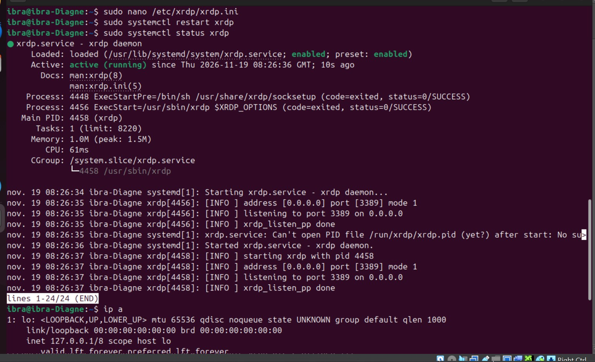

Capture 2 : le service xrdp est actif et écoute sur le port 3389

### Étape 3 : trouver l'adresse IP de la machine Ubuntu

```
ip a
```

Cette commande liste les cartes réseau et leurs adresses. La carte enp0s3, en accès par pont dans VirtualBox, a l'adresse 192.168.1.78 sur le réseau local. Les adresses 10.0.2.15 (NAT de VirtualBox) et 127.0.0.1 (boucle locale) ne sont pas joignables depuis Windows.

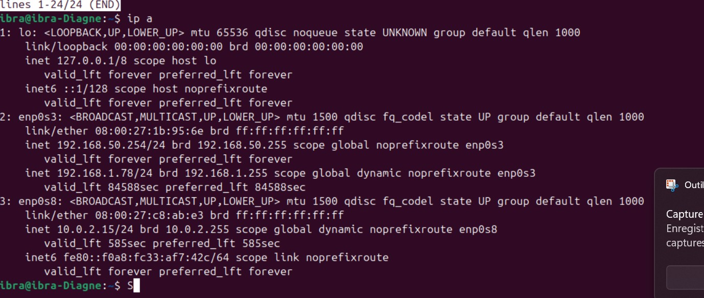

Capture 3 : adresses IP de la machine Ubuntu

**Problème rencontré : « Connection timed out » à la connexion SSH**

Cause : j'ai d'abord utilisé l'ancienne adresse de la machine (192.168.1.92), puis la première tentative vers 192.168.1.78 n'a pas abouti. En accès par pont, la box donne l'adresse par DHCP et elle peut changer d'un jour à l'autre.

Solution : vérifier l'adresse actuelle avec `ip a` avant de se connecter, puis relancer la commande vers 192.168.1.78. La connexion est passée.

### Étape 4 : créer le tunnel SSH depuis Windows

```
ssh -L 13389:127.0.0.1:3389 ibra@192.168.1.78
```

Le port 13389 de Windows est relié au port 3389 de la machine Ubuntu, là où écoute xrdp. On choisit 13389 et pas 3389, car le port 3389 peut déjà être utilisé par Windows pour son propre bureau à distance.

À la première connexion, SSH affiche l'empreinte (fingerprint) de la clé du serveur. On l'accepte avec « yes », et elle est enregistrée dans known_hosts. Le tunnel reste actif tant que cette fenêtre est ouverte.

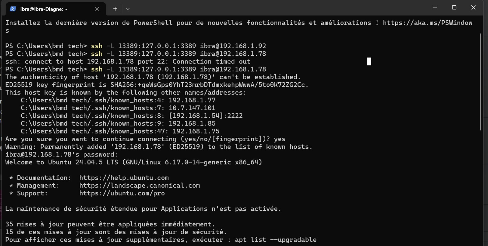

Capture 4 : création du tunnel et vérification de l'empreinte du serveur

### Étape 5 : se connecter avec le client Bureau à distance

On ouvre « Connexion Bureau à distance » (mstsc) sur Windows. Dans le champ Ordinateur, on met `127.0.0.1:13389`, c'est-à-dire l'entrée du tunnel, puis on s'identifie avec le compte Ubuntu.

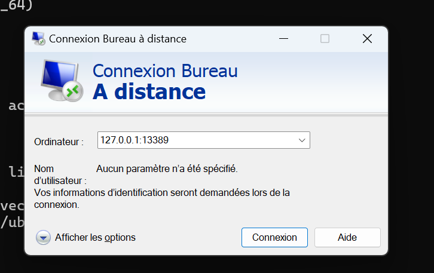

Capture 5 : client RDP de Windows connecté au tunnel

### Étape 6 : le bureau à distance côté Windows

Windows peut aussi être contrôlé à distance. Le réglage se trouve dans Paramètres, Système, Bureau à distance. L'interrupteur active ou désactive l'accès. Ici il est désactivé, donc personne ne peut prendre le contrôle du PC.

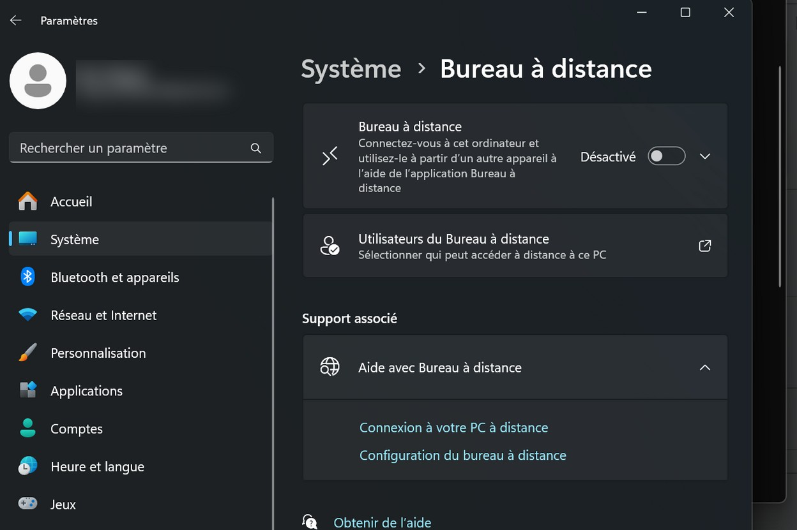

Capture 6 : paramètres du Bureau à distance sous Windows

« Utilisateurs du Bureau à distance » permet de choisir qui a le droit de se connecter. Les administrateurs ont toujours accès, d'où le message « bmd tech a déjà un accès ». Pour ajouter un compte, on clique sur Ajouter, on tape son nom, puis « Vérifier les noms » pour que Windows confirme qu'il existe, et OK.

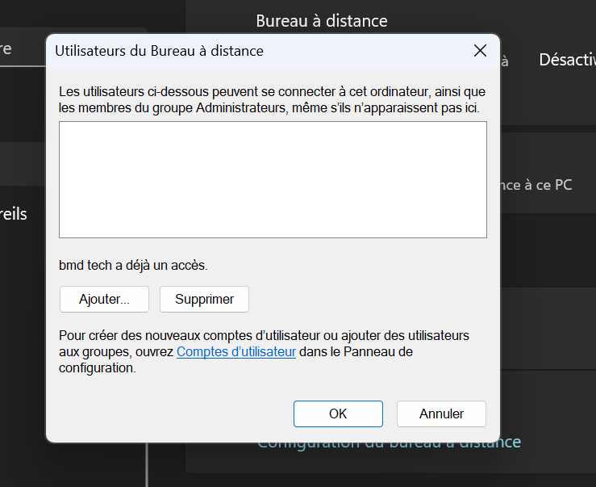

Capture 7 : liste des utilisateurs autorisés

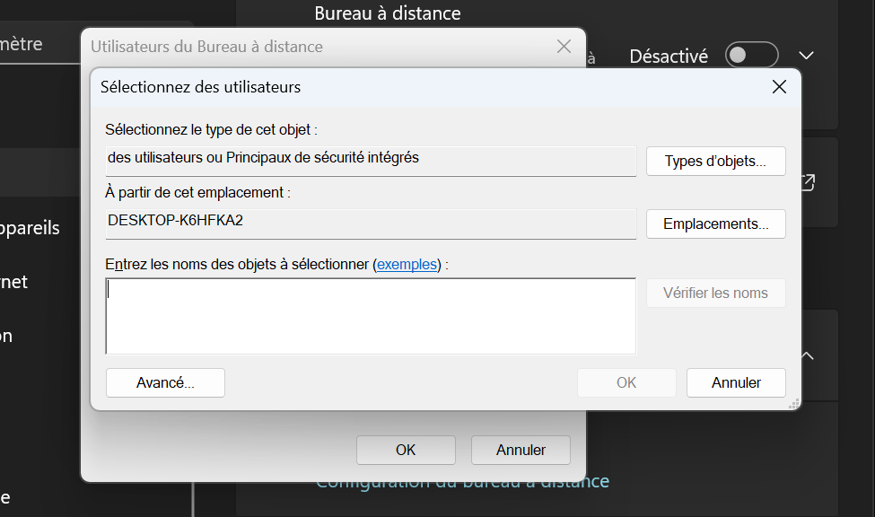

Capture 8 : ajout d'un utilisateur autorisé

## 5. Partie 2 : VNC avec TigerVNC

VNC (Virtual Network Computing) est un autre protocole de bureau à distance. Le serveur envoie des images de l'écran, et le client renvoie les clics et les touches. Chaque écran VNC a un numéro : l'écran :1 utilise le port 5901, l'écran :2 le port 5902, et ainsi de suite (5900 + numéro). Comme le prof, j'utilise l'écran :2.

### Étape 7 : installer le serveur TigerVNC

```
sudo apt install tigervnc-standalone-server tigervnc-common -y
```

tigervnc-standalone-server crée un écran virtuel indépendant, qui n'est pas l'écran physique de la machine. tigervnc-tools, qui contient vncpasswd, est ajouté automatiquement.

**Problème rencontré : « Impossible de trouver le paquet tigervmc-standalone-server »**

Cause : une faute de frappe, « vmc » au lieu de « vnc ».

Solution : retaper le bon nom. VNC vient de Virtual Network Computing.

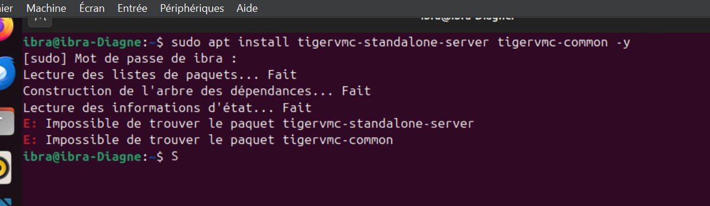

Capture 9 : erreur due à la faute de frappe

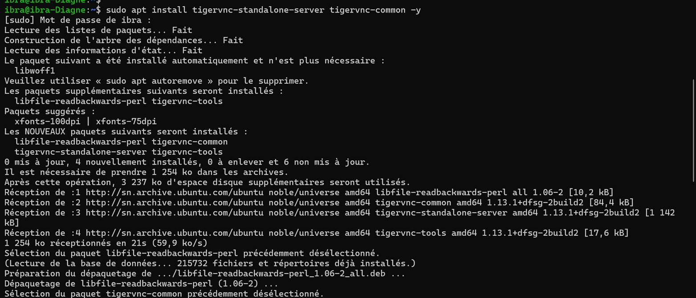

Capture 10 : installation correcte de TigerVNC

`tigervncserver -version` confirme l'installation, en version 1.13.1.

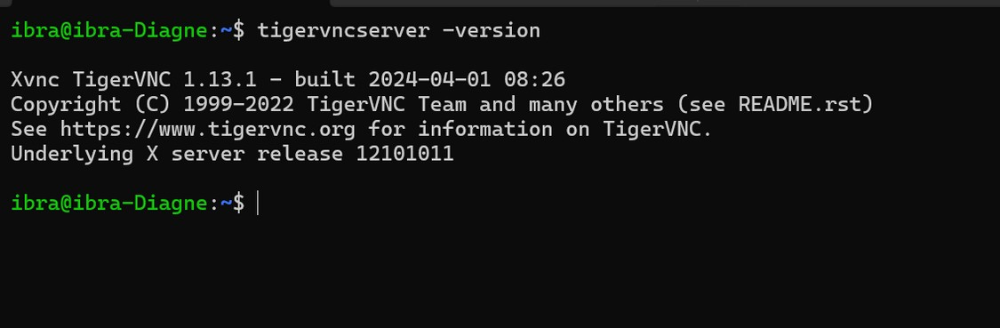

Capture 11 : version de TigerVNC

### Étape 8 : installer un bureau léger, XFCE

```
sudo apt update
sudo apt install -y xfce4 xfce4-goodies dbus-x11
```

VNC doit afficher un environnement de bureau. GNOME, le bureau d'Ubuntu, fonctionne mal dans une session VNC. On installe donc XFCE, qui est plus léger. dbus-x11 permet aux programmes du bureau de communiquer entre eux.

**Problème rencontré : « Could not get lock /var/lib/dpkg/lock-frontend »**

Cause : une deuxième commande apt a été lancée pendant que la première tournait encore. Un seul apt peut travailler à la fois.

Solution : attendre la fin de la première installation. Il faut toujours attendre le retour du prompt avant de lancer la commande suivante.

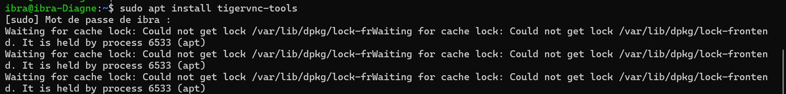

Capture 12 : apt attend que l'autre installation se termine

**Problème rencontré : erreurs « 404 Not Found » sur mesa-va-drivers**

Cause : la liste des paquets de la machine n'était plus à jour. Elle pointait vers une ancienne version que le dépôt avait déjà supprimée. XFCE ne s'est donc pas installé, et `which startxfce4` ne répondait rien.

Solution : `sudo apt update` télécharge la liste à jour, puis on relance l'installation.

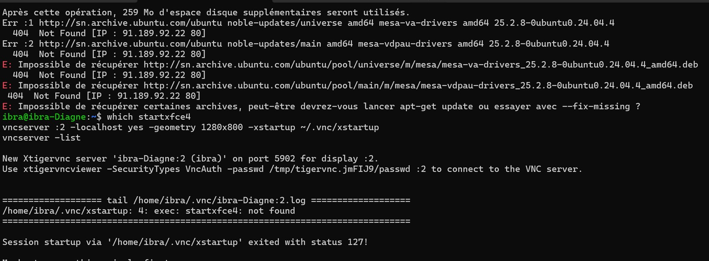

Capture 13 : échec de l'installation à cause de la liste périmée

Pendant l'installation, une fenêtre demande quel gestionnaire d'affichage utiliser (l'écran de connexion au démarrage). J'ai gardé gdm3, celui d'Ubuntu, pour ne rien changer à la machine.

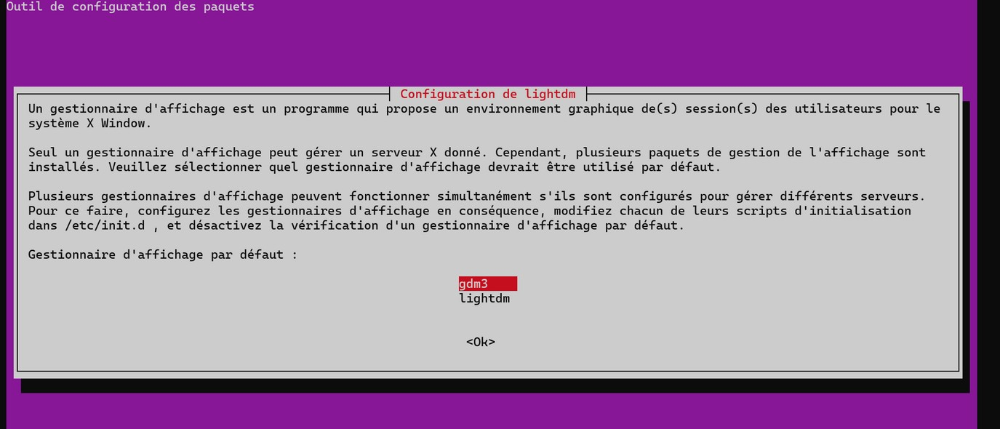

Capture 14 : choix du gestionnaire d'affichage

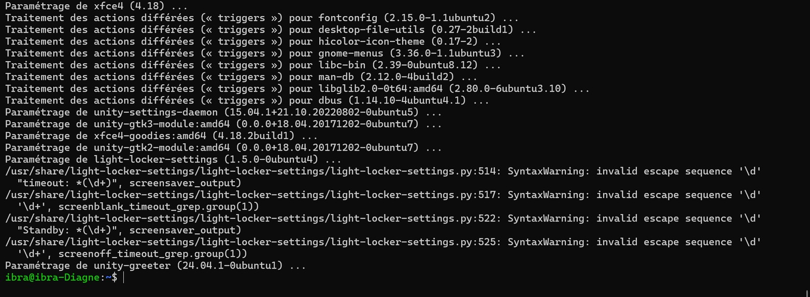

Capture 15 : XFCE est installé

### Étape 9 : configurer le serveur VNC

```
mkdir -p ~/.vnc
nano ~/.vnc/config
vncpasswd
```

Le fichier `~/.vnc/config` contient les réglages par défaut. `localhost=yes` est le réglage le plus important : le serveur n'accepte que les connexions venant de la machine elle-même, ce qui oblige à passer par le tunnel SSH. `geometry` fixe la résolution, et `depth=24` le nombre de bits par couleur.

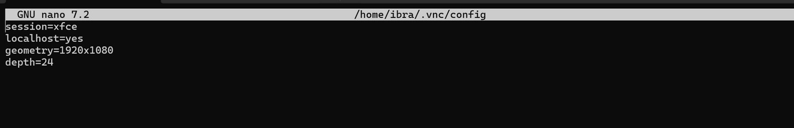

Capture 16 : fichier ~/.vnc/config

`vncpasswd` définit le mot de passe demandé au client. Il propose aussi un mot de passe « view-only », qui permet seulement de regarder l'écran. Seuls les 8 premiers caractères du mot de passe sont pris en compte.

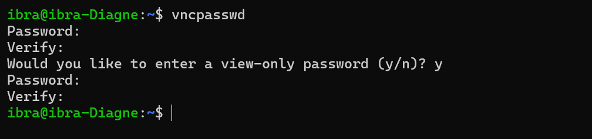

Capture 17 : définition du mot de passe VNC

### Étape 10 : le script de démarrage xstartup

`~/.vnc/xstartup` dit au serveur ce qu'il doit lancer dans la session VNC. Voici la version finale qui fonctionne :

```
#!/bin/sh
unset SESSION_MANAGER
unset DBUS_SESSION_BUS_ADDRESS
unset WAYLAND_DISPLAY
export XDG_SESSION_TYPE=x11
export GDK_BACKEND=x11
export XKL_CFG_DIR=/etc/X11/xkb
[ -r $HOME/.Xresources ] && xrdb $HOME/.Xresources
exec dbus-launch --exit-with-session startxfce4
```

Les `unset` effacent les variables héritées de la session GNOME déjà ouverte sur la machine, pour que XFCE ne s'y rattache pas. `XDG_SESSION_TYPE=x11` et `GDK_BACKEND=x11` obligent les applications à s'afficher sur l'écran X11 créé par VNC. `XKL_CFG_DIR` indique où trouver la configuration du clavier. `dbus-launch` crée le bus de communication dont XFCE a besoin, puis `startxfce4` lance le bureau.

Le fichier doit être rendu exécutable :

```
chmod +x ~/.vnc/xstartup
```

### Étape 11 : démarrer et vérifier le serveur

```
vncserver :2 -localhost yes -geometry 1280x800 -xstartup ~/.vnc/xstartup
vncserver -list
ss -tlnp | grep 5902
```

`vncserver -list` montre l'écran 2 sur le port 5902. `ss -tlnp` montre que Xtigervnc écoute seulement sur l'adresse locale (127.0.0.1 et ::1), donc il n'est pas joignable directement depuis le réseau.

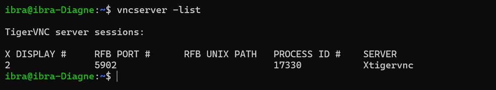

Capture 18 : la session VNC tourne sur l'écran 2

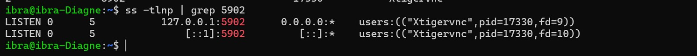

Capture 19 : le serveur n'écoute que sur l'adresse locale

**Problème rencontré : « A VNC server is already running as :2 », alors que la liste est vide**

Cause : `ss -tlnp | grep 5902` a montré que le port 5902 était occupé par ssh. J'avais lancé par erreur un tunnel depuis la machine Ubuntu vers elle-même, et il gardait ce port.

Solution : fermer cette session SSH avec `exit`. Le port est libéré et le serveur peut démarrer.

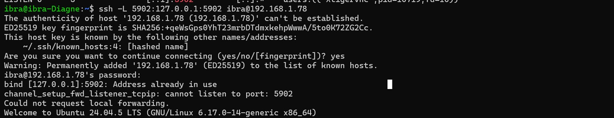

Capture 20 : « Address already in use », le tunnel lancé par erreur depuis la machine Ubuntu

### Étape 12 : créer le tunnel depuis Windows

Dans un PowerShell Windows, avec le prompt `PS C:\Users\...` :

```
ssh -L 5902:127.0.0.1:5902 ibra@192.168.1.78
```

Le port 5902 de Windows est relié au port 5902 de la machine Ubuntu. La fenêtre doit rester ouverte pendant toute la session VNC.

**Problème rencontré : « Aucune connexion n'a pu être établie car l'ordinateur cible l'a expressément refusée »**

Cause : le client VNC se connectait au port 5902 de Windows, mais le tunnel n'était pas ouvert sur Windows. J'avais tapé la commande dans une session déjà connectée à la machine Ubuntu.

Solution : ouvrir un nouveau PowerShell Windows, vérifier que le prompt commence bien par `PS C:\`, puis y lancer le tunnel.

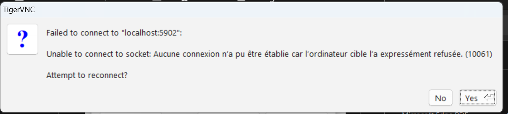

Capture 21 : connexion refusée, le tunnel n'est pas ouvert sur Windows

### Étape 13 : se connecter avec TigerVNC Viewer

Le client se télécharge sur la page de TigerVNC (SourceForge). J'ai pris le fichier `vncviewer64-1.16.2.exe`, qui fonctionne sans installation. Dans le champ VNC server, on tape `localhost:5902`, puis le mot de passe VNC.

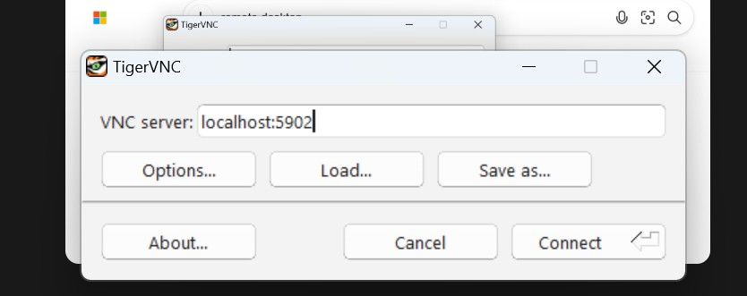

Capture 22 : client TigerVNC Viewer

L'avertissement « This connection is not secure » veut dire que le chiffrement propre à VNC n'est pas activé. Ici ce n'est pas grave, car tout passe déjà dans le tunnel SSH, qui est chiffré. On peut cliquer sur OK.

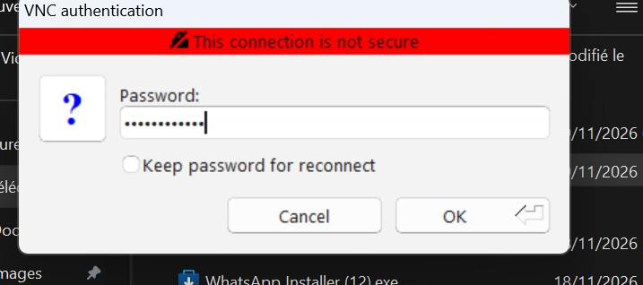

Capture 23 : authentification VNC

**Problème rencontré : écran noir après la connexion**

Cause 1 : XFCE n'arrivait pas à démarrer sans son bus de communication D-Bus.

Solution 1 : lancer XFCE avec `exec dbus-launch --exit-with-session startxfce4` dans xstartup.

Cause 2 : le journal `~/.vnc/ibra-Diagne:2.log` indiquait « Unable to open display … wayland-0 ». Ubuntu utilise Wayland, et XFCE avait hérité de ses variables : il essayait de s'afficher sur l'écran Wayland de GNOME au lieu de l'écran VNC.

Solution 2 : dans xstartup, supprimer `WAYLAND_DISPLAY` et forcer X11 avec `XDG_SESSION_TYPE=x11` et `GDK_BACKEND=x11`, puis redémarrer le serveur avec `vncserver -kill :2` et le relancer.

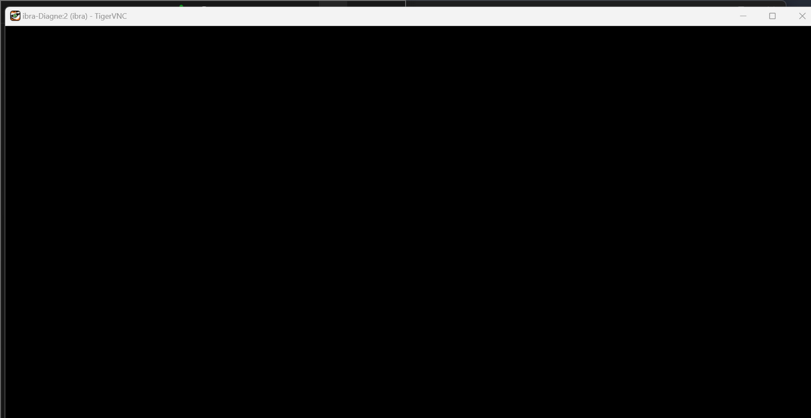

Capture 24 : écran noir, le bureau ne s'affiche pas

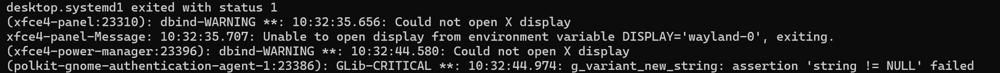

Capture 25 : le journal montre que XFCE cherche l'écran Wayland

Après la correction, on relit le journal. Le serveur Xtigervnc tourne sur l'écran :2 (port 5902) et startxfce4 trouve bien l'écran :2. Les lignes qui restent sont des avertissements D-Bus qui n'empêchent pas le bureau de s'afficher.

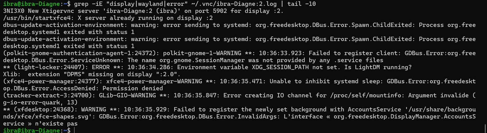

Capture 26 : journal du serveur VNC après la correction

### Résultat

Le bureau XFCE de la machine Ubuntu s'affiche dans TigerVNC sur Windows. On peut l'utiliser avec la souris et le clavier comme si on était devant la machine. Pour arrêter le serveur à la fin :

```
vncserver -kill :2
```

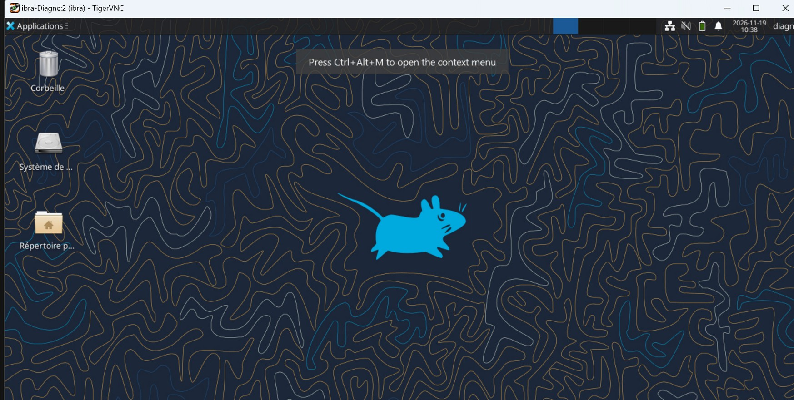

Capture 27 : bureau XFCE affiché à distance dans TigerVNC

## 6. Conclusion

RDP et VNC permettent tous les deux d'utiliser une machine à distance avec une interface graphique. Avec RDP, xrdp joue le rôle de serveur sur Ubuntu et le client intégré de Windows s'y connecte. Avec VNC, TigerVNC fournit le serveur et le client, et XFCE sert de bureau.

Dans les deux cas, le tunnel SSH chiffre le trafic. Pour VNC, le serveur n'écoute qu'en local, donc le port 5902 n'est pas exposé sur le réseau. Pour xrdp, le service écoute sur toutes les adresses (0.0.0.0) : pour qu'il ne soit joignable que par le tunnel, il faudrait aussi le limiter à 127.0.0.1 dans xrdp.ini.

Ce TP m'a surtout appris à lire les journaux (`systemctl status`, `~/.vnc/*.log`), à vérifier les ports avec `ss -tlnp`, et à toujours regarder sur quelle machine je tape une commande avant d'appuyer sur Entrée.
